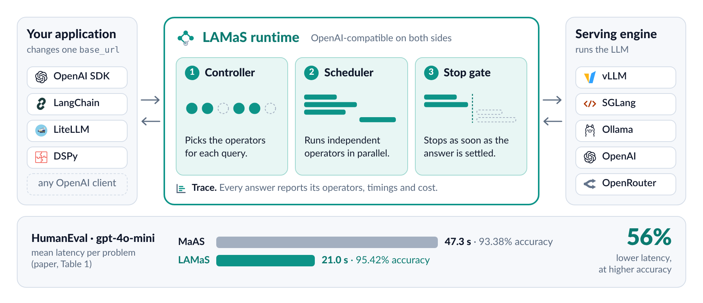
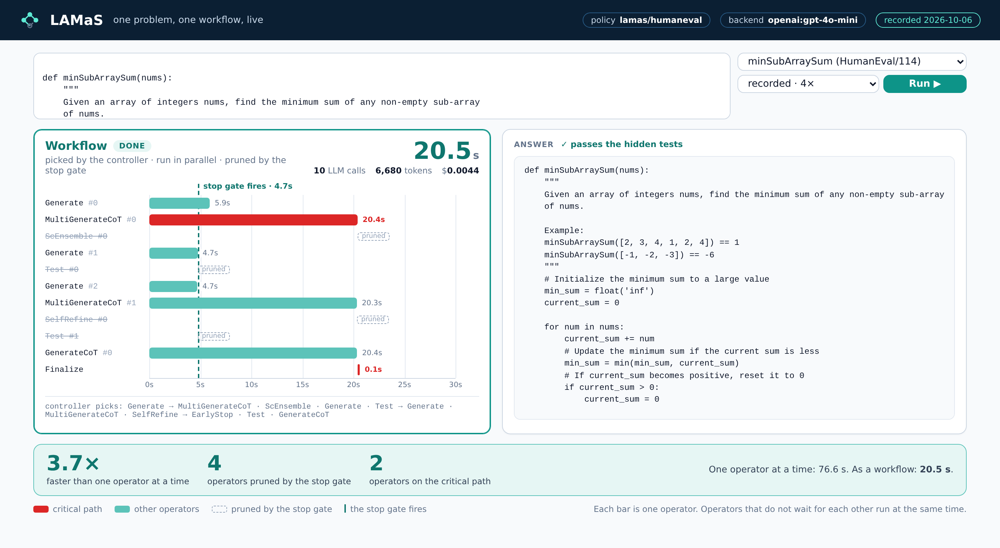
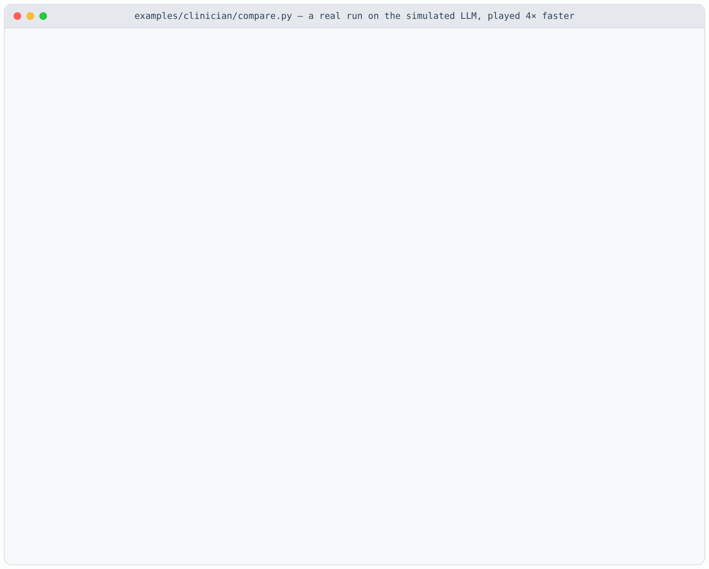

<p align="center">
  
</p>

<h1 align="center">LAMaS: A Modular Platform for Learning Low-Latency Multi-Agent Orchestration</h1>

<p align="center">
  Send a query to LAMaS, or keep your framework’s graph builder and use the latency-optimized orchestration layer.
</p>

<p align="center">
  <a href="https://arxiv.org/abs/2601.10560"></a>
  <a href="https://arxiv.org/abs/2601.10560"></a>
  <a href="pyproject.toml"></a>
  <a href="#drop-in-endpoint"></a>
  <a href="LICENSE"></a>
</p>

<p align="center">
  <a href="#quickstart"><b>Quickstart</b></a> ·
  <a href="#demo"><b>Demo</b></a> ·
  <a href="#drop-in-endpoint"><b>Endpoint</b></a> ·
  <a href="#use-your-own-graph-builder"><b>Framework integration</b></a> ·
  <a href="#how-it-works"><b>How it works</b></a> ·
  <a href="#extending-it"><b>Extending</b></a> ·
  <a href="#qa"><b>Q&amp;A</b></a> ·
  <a href="policies/humaneval"><b>Policy</b></a> ·
  <a href="https://arxiv.org/abs/2601.10560"><b>Paper</b></a>
</p>

In a multi-agent system (MAS), the time a user waits depends on the **critical path**, the longest chain of dependent agent calls. LAMaS learns which calls to run and when to stop. During training, operators on the critical path receive the largest latency penalty under a target floor on expected accuracy. During inference, a lightweight controller uses partial results to decide whether to skip calls that have yet to start.

An application can send a query to the OpenAI-compatible endpoint and receive an answer with a trace of operator timings, critical path, and cost. A framework can also keep its own graph builder and reuse the orchestration layer. The paper evaluates this integration with GDesigner and AgentDropout across GSM8K, HumanEval, MATH, and MMLU-Pro.

<p align="center">
  <picture>
    <source media="(prefers-color-scheme: dark)" srcset="docs/assets/overview-dark.png">
    
  </picture>
</p>

Across four benchmarks, LAMaS reduced end-to-end latency by over 50% relative to the evaluated learning-based MAS baselines, with competitive or better accuracy. [NeurIPS 2026 paper](https://arxiv.org/abs/2601.10560)

## Highlights

- **Comparison with MaAS.** LAMaS had 56% to 76% lower latency than MaAS across four benchmarks, at equal or higher accuracy (Table 1).
- **Drop-in.** `lamas serve` is an OpenAI-compatible endpoint. The application changes one `base_url` and keeps its code.
- **Any serving engine.** vLLM, SGLang, Ollama, OpenAI, OpenRouter: anything that speaks the OpenAI API.
- **A trained policy in the box.** [`lamas/humaneval`](policies/humaneval), the controller and the stop gate behind the paper's HumanEval results, loads by default.
- **Every answer is explained.** Each run returns a trace: which operators ran, how long each took, which ones set the latency (the critical path), what the stop gate pruned, and what it cost.
- **Custom workflows.** You can run a hand-written workflow with your own data, prompts, and tools before training a policy. [Tutorial](docs/tutorial.md) · [Extension guide](docs/extending.md)

## Quickstart

```bash
pip install -e ".[all]"                    # runtime + trained policy support + endpoint

python examples/quickstart.py              # one problem, simulated LLM, no API key needed
lamas demo --backend mock                  # the demo page, offline: http://127.0.0.1:8080/demo

export OPENAI_API_KEY=...                  # or any OpenAI-compatible serving engine, see configs/
lamas demo                                 # the same page, live
```

Solve one problem from the shell or from Python:

```bash
lamas run configs/humaneval-gpt4omini.yaml 'def add(a, b):\n    """Return a + b."""'
```

```python
import lamas

result = lamas.run(problem, backend="http://localhost:8000/v1")   # vLLM, SGLang, Ollama, OpenAI ...
print(result.answer)               # the function
print(result.trace.gantt())        # which operators ran, the critical path, what the stop gate pruned
```

## Demo

`lamas demo` opens a page that solves one problem and draws its workflow while it runs. Each bar is
one operator. Red bars are the critical path. Dashed boxes are operators that the stop gate pruned.



The page also replays recorded runs, so it can be shown without a serving engine.

## Drop-in endpoint

```bash
lamas serve configs/humaneval-gpt4omini.yaml --port 8080
```

```python
from openai import OpenAI

client = OpenAI(base_url="http://localhost:8080/v1", api_key="not-needed")
problem = "def add(a, b):\n    \"\"\"Return the sum of a and b.\"\"\""
reply = client.chat.completions.create(model="lamas/auto", messages=[{"role": "user", "content": problem}])
print(reply.choices[0].message.content)
trace = reply.model_extra["lamas"]
print(trace["critical_path"], trace["cost"])
```

Point your framework’s chat client at the URL above and select `lamas/auto` to run the policy loaded by the server. The answer is in the standard chat completion and the `lamas` field contains the execution trace. The `x-lamas-*` headers summarize latency, LLM calls, critical path, and pruned operators. To request a per-query latency budget, pass `extra_body={"lamas": {"budget": {"latency_s": 10}}}`.

## Use your own graph builder

If your framework already selects agents for each query, map those agents to registered LAMaS operators and pass their names to the runtime in layers. In this example, two agents can generate candidates in parallel. The ensemble depends on their outputs. The agreement rule can skip the ensemble if both candidates agree.

```python
import lamas

layers = [["Generate", "GenerateCoT"], ["ScEnsemble"]]  # Output from your graph builder
result = lamas.run(
    "What is 6 * 7?",
    policy={
        "controller": {"type": "fixed", "layers": layers},
        "stop": {"type": "agreement", "min_solutions": 2},
    },
    backend="mock",
)
print(result.answer)
print(result.trace.gantt())
```

Use `backend="mock"` to try this offline, or supply your serving engine. To let LAMaS call your builder for every query, implement `Controller.select` and return `Selection(layers=...)`. The scheduler derives dependencies from the inputs each operator declares. [Controller interface](src/lamas/controllers/base.py) · [Custom operators](docs/extending.md)

**Training the layer for another framework.** The paper integrated LAMaS into GDesigner and AgentDropout in two steps.

1. Train the framework’s graph policy with its existing builder. Score each run against the task, assign the greatest latency penalty to operators on the critical path, and update the policy under the target accuracy floor. A custom training loop can obtain per-operator rewards from `Objective.node_rewards(trace, score)`. [Training objective](src/lamas/objective.py)
2. Freeze the graph policy and collect full execution traces. At each operator completion, compare the reward for stopping there with the reward for finishing the graph. Fit the stop controller to that difference. At inference time it uses partial results to decide whether to launch the remaining operators. [Trace collection and gate fitting](src/lamas/training.py)

On HumanEval, this reduced GDesigner’s mean latency from **49.68 s to 30.85 s** and AgentDropout’s from **51.49 s to 36.62 s** per query (Table 3). These results use a controller trained on each framework’s traces. The runnable example above uses the built-in agreement rule.

## One config

```yaml
backend:                                # the serving engine
  base_url: http://localhost:8000/v1    # any OpenAI-compatible endpoint
  model:    qwen3.5-9b
policy:     lamas/humaneval             # the trained controller + stop gate
budget:     {latency_s: 15}             # optional latency deadline
```

Only the backend is required.

## How it works

1. **Train the graph policy.** Given a query, the policy selects agent steps called operators. Training weighs wall-clock latency and cost against a target floor on expected task accuracy.
2. **Assign credit to operators.** Operators on the longest dependency chain receive the full latency penalty. Operators on shorter paths receive a smaller share.
3. **Use partial results at run time.** The scheduler starts operators as their inputs become available. After each completion, the learned stop controller decides whether to skip pending work. The trace records which calls ran, which calls set the critical path, and which were skipped.

## The runtime: six primitives

| Primitive | What it does | Shipped |
|---|---|---|
| `Operator` | One agent step. It reads the problem or earlier solutions, and returns a solution. | `Generate`, `GenerateCoT`, `MultiGenerateCoT`, `ScEnsemble`, `SelfRefine`, `Test` |
| `Controller` | Picks the operators for each query. | the controller trained in the paper |
| `Scheduler` | Orders the picked operators. Independent ones run in parallel. | starts an operator when its inputs are ready |
| `StopPolicy` | Decides after each operator whether to stop early. | the learned stop gate |
| `Objective` | The training goal for the controller and the stop gate. | accuracy floor, critical-path credit, cost |
| `Trace` | The record of one run: operators, timings, tokens, critical path. | JSON, text Gantt chart, live events |

`Operator` and `Controller` are slots for components: anyone can plug in a new one. The runtime owns
the other four, and they are the same for every controller.

`lamas.run` is `lamas.plan` (controller, scheduler) followed by `lamas.execute` (executor, stop gate).

## Extending it

**A new operator is one file.** `needs` tells the scheduler where it goes; `description` is what the
controller reads, so it can pick an operator it was never trained with
([examples/custom_operator.py](examples/custom_operator.py)).

```python
from lamas import Operator, register_operator

@register_operator
class Debate(Operator):
    name        = "Debate"
    description = "Two agents argue for and against the current solution; a judge decides."
    needs       = "solution"            # problem | solution | solutions

    async def run(self, ctx):
        pro, con = await ctx.gather(ctx.ask(PRO), ctx.ask(CON))
        return await ctx.ask(JUDGE, pro=pro, con=con)
```

Controllers (`@register_controller`), stop policies, serving engines and tasks register the same way,
and third-party packages can register through entry points (`lamas.operators`, `lamas.controllers`, ...).

**A new domain is one config.** Your data, your prompts, your tools and a hand-written workflow, with
no training: the scheduler, the stop policy, the trace and the endpoint work as they do for HumanEval.

```yaml
plugins: [tools.py]                          # your operators: retrieval, a calculator, an API
task:
  name:   custom
  data:   {test: orders.jsonl}               # your dataset
  fields: {problem: question, answer: total}
  prompts: {solve_instruction: "You work at the front desk of a shop. ..."}
policy:
  controller: {type: fixed, layers: [[PriceLookup, Calculator], [ScEnsemble]]}
  stop:       {type: agreement, min_solutions: 2}
```

The guide, [docs/extending.md](docs/extending.md), covers datasets and answer formats, prompts, tools,
plugins, workflows without training, task classes and packaging. The example above is
[examples/extend](examples/extend).

## Where it plugs in

| Level | How | Works with | Status |
|---|---|---|---|
| L0 Endpoint | `lamas serve`, change `base_url` | OpenAI SDK, LangChain, curl, any OpenAI client | today |
| L1 Provider | `lamas.adapters.litellm_provider.register(runner)` | LiteLLM and what is built on it (DSPy) | today |
| L2 Native | a node or module that exposes the workflow and the trace | LangGraph, DSPy, MCP | later |
| L3 Train | `lamas train` fits the bundled graph policy and stop controller | tasks with a training split and scorer | available for the LAMaS policy |

Downstream, LAMaS talks to any OpenAI-compatible serving engine: vLLM, SGLang, Ollama, OpenAI, OpenRouter.

## The released policy

[`policies/humaneval`](policies/humaneval) holds the controller and the stop gate behind the HumanEval
results of the paper, with a model card and checksums.

| HumanEval test split, gpt-4o-mini (paper, Table 1) | Accuracy | Latency per problem |
|---|---|---|
| Single LLM call | 84.73% | 10.23 s |
| MaAS | 93.38% | 47.32 s |
| **LAMaS** | **95.42%** | **21.00 s** |

Details are in the [model card](policies/humaneval/README.md).

```bash
lamas eval configs/humaneval-gpt4omini.yaml --out runs/humaneval     # the whole test split
lamas plan 'def add(a, b):\n    """Return a + b."""'                   # show a workflow without running it
lamas list                                                            # operators, tasks, installed policies
```

Every report covers accuracy, latency (mean, P50, P90), cost (dollars, LLM calls) and what the stop
gate did.

## Repository layout

```
src/lamas/          the runtime: api, scheduler, executor, stop, objective, controllers, operators, tasks, serve
policies/humaneval  the released policy and its model card
data/               the HumanEval train and test splits and the public test cases
configs/            example configs
examples/           quickstart, OpenAI client, custom operator, LiteLLM provider;
                    extend/: a new domain in one config; clinician/: the tutorial's clinician team on MedQA
scripts/            make_demo.py: turn an evaluation run into the demo's recorded runs
tests/              pytest suite; runs offline on a simulated LLM
docs/               tutorial.md (a multi-agent system for your domain, step by step), extending.md (the
                    guide to new domains, data, prompts and tools) and the figures of this page
```

## Status and roadmap

| | What | Status |
|---|---|---|
| 1 | **The runtime**: the six primitives, the trained policy, `lamas run / plan / eval` | today |
| 2 | **Drop-in**: `lamas serve` (OpenAI-compatible), the demo with recorded runs, the LiteLLM provider | today |
| 3 | **Public release**: a full training run with `lamas train`, the policy on the Hugging Face Hub | next |
| 4 | **Ecosystem and arena**: more controllers and tasks, LangGraph node, DSPy module, MCP tool, a plug-in for the vLLM Semantic Router, a public efficiency leaderboard | later |

API keys are read from the environment (`$LAMAS_API_KEY`, then `$OPENAI_API_KEY`) and never written to
configs, traces or reports; `tests/test_no_secrets.py` fails if a key-shaped string appears anywhere in the tree.

`Test` executes generated code in a child process with a time limit. For untrusted workloads, run LAMaS in a container.

## Q&A

### Q1. How do I use LAMaS to build an efficient and accurate multi-agent system for another domain, for example a team of clinicians?

Follow the [step-by-step tutorial](docs/tutorial.md). It builds a team of four clinician agents that
answers MedQA (USMLE) questions, and measures its latency and accuracy with LAMaS and without. In
short:

**1. Set up your LLM**: a local model, or a hosted API with your key.

```bash
# a local model on your GPU: vLLM serves Qwen3.5-9B, with its thinking turned off
vllm serve Qwen/Qwen3.5-9B --served-model-name qwen3.5-9b --port 8000 \
    --language-model-only --max-model-len 16384 \
    --reasoning-parser qwen3 --default-chat-template-kwargs '{"enable_thinking": false}'

# or a hosted API: the key goes in an environment variable, never in the config
export LAMAS_API_KEY=...
```

[Step 1 of the tutorial](docs/tutorial.md#step-1-set-up-your-llm) also covers Ollama on a laptop and
other providers. No model yet? Step 5 runs on a simulated LLM too.

**2. Put your dataset in place**: a JSONL file next to your config, one case per line
([examples/clinician/data](examples/clinician/data)).

**3. Write your agents.** Each agent is one async function. `needs` says what it reads, so LAMaS
knows what it waits for.

```python
@lamas.operator(needs="problem")       # reads only the case: starts at once
async def Internist(ctx):
    """An internist reads the whole case: the history, the findings and the tests."""
    return await ctx.ask(ASK, role="an internist",
                         focus="Weigh the history, the findings and the tests.")

@lamas.operator(needs="solutions")     # reads the team's answers: waits for them
async def Attending(ctx):
    """The attending physician reads the team's answers and decides."""
    return await ctx.ask(DECIDE)
```

**4. Describe the task, the workflow and the LLM in one config**: where the data is, how answers
are compared, the order of the agents, when to stop, and which LLM to use
([clinician.yaml](examples/clinician/clinician.yaml)).

```yaml
policy:
  controller: {type: fixed, layers: [[Internist, Pathologist, Pharmacist], [Attending]]}
  stop: {type: agreement, min_solutions: 3}       # all three agree: the attending is not needed
backend:                                          # the LLM of step 1
  base_url: http://localhost:8000/v1              # or https://api.openai.com/v1
  model:    qwen3.5-9b                            # or gpt-4o-mini
```

**5. Compare with LAMaS and without**, in a few lines:

```python
report = lamas.compare("examples/clinician/clinician.yaml")
print(report.table())
```

```bash
python examples/clinician/compare.py --backend http://localhost:8000/v1 --model qwen3.5-9b
python examples/clinician/compare.py        # no model yet: the same on a simulated LLM
```

<p align="center">
  
  <br><sub>A real run of step 5 on the simulated LLM, played 4× faster.</sub>
</p>

Without LAMaS, the agents run one after another and all of them run. With LAMaS, the three
clinicians run at the same time, and the attending is pruned when they agree. On your LLM, the
table also compares accuracy.

## Citation

```bibtex
@inproceedings{shi2026lamas,
  title     = {{LAMaS}: A Modular Platform for Learning Low-Latency Multi-Agent Orchestration},
  author    = {Shi, Xi and Zheng, Mengxin and Lou, Qian},
  booktitle = {Advances in Neural Information Processing Systems},
  year      = {2026}
}
```

The controller architecture and the operator library build on MaAS (Zhang et al., ICML 2025).

## License

LAMaS is released under the [Apache License 2.0](LICENSE). Material from other projects is listed in [NOTICE](NOTICE).
