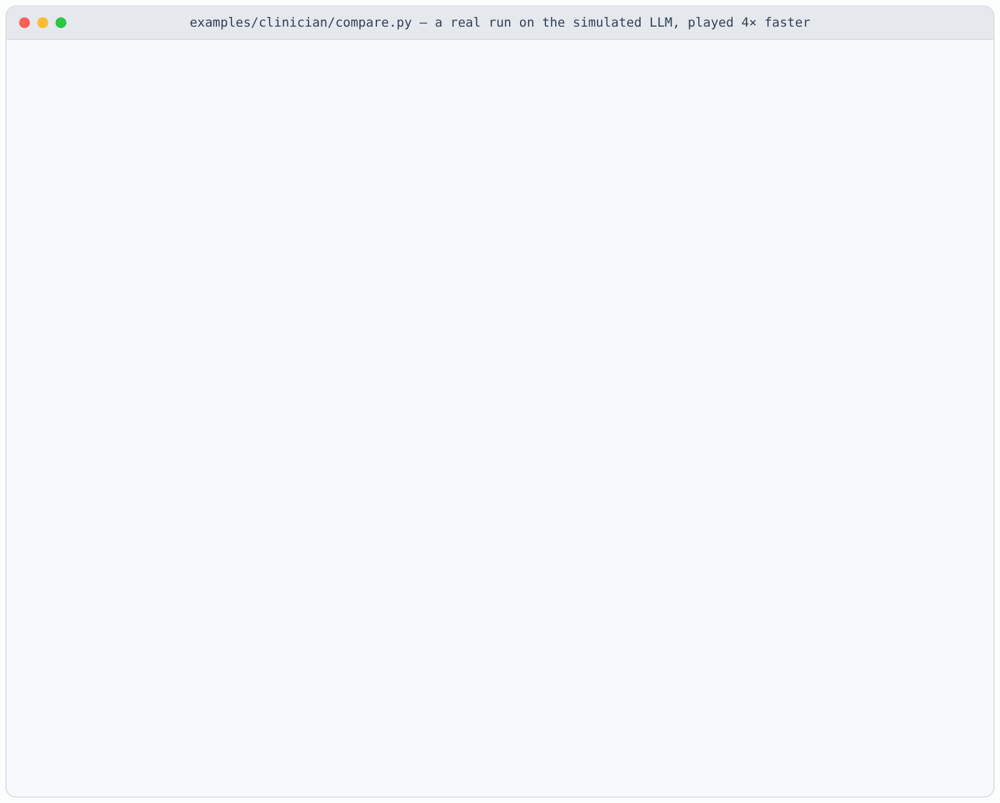

# Tutorial: your multi-agent system on LAMaS, step by step

This tutorial takes a small multi-agent system from nothing to a measured comparison. The system
is a team of four clinician agents that answers medical exam questions from MedQA. At the end,
a few lines of Python run the team twice on the same cases, once without LAMaS and once with it,
and print the difference.

Every step runs on your laptop first, on a simulated LLM, with no GPU and no API key. Each step
then says what changes on a real model.

<p align="center">
  
  <br><sub>Step 5 on the simulated LLM: a real run, played 4× faster.</sub>
</p>

**Without LAMaS** means the way a plain multi-agent loop runs the same team: one agent after
another, and every agent runs. **With LAMaS**, agents that do not wait for each other run at the
same time, and a stop policy skips the agents that are no longer needed. The agents, their prompts
and the LLM are the same in both.

| Step | You do | File |
|---|---|---|
| [0](#step-0-install) | Install LAMaS | |
| [1](#step-1-put-your-dataset-in-place) | Put your dataset in place | `examples/clinician/data/medqa_sample.jsonl` |
| [2](#step-2-write-your-agents) | Write your agents | `examples/clinician/clinicians.py` |
| [3](#step-3-describe-the-task-and-the-workflow) | Describe the task and the workflow | `examples/clinician/clinician.yaml` |
| [4](#step-4-run-one-case) | Run one case and read its trace | |
| [5](#step-5-compare-with-lamas-and-without) | Compare with LAMaS and without | `examples/clinician/compare.py` |
| [6](#step-6-run-it-on-a-real-model) | Run it on a real model | |
| [7](#step-7-bring-your-own-system) | Bring your own system | |

All files of the example are in one folder:

```
examples/clinician/
  data/medqa_sample.jsonl   step 1: the dataset, ten MedQA cases
  get_medqa.py              step 1: downloads the full MedQA test split
  clinicians.py             step 2: the four agents
  clinician.yaml            step 3: the task and the workflow
  compare.py                step 5: with LAMaS and without
```

## Step 0. Install

```bash
git clone https://github.com/UCF-ML-Research/LAMaS.git
cd LAMaS
pip install -e . pytest
```

Check that everything in this tutorial works on your machine. These tests run offline in a second:

```bash
python -m pytest -q tests/test_clinician_tutorial.py
```

## Step 1. Put your dataset in place

**The dataset.** [MedQA](https://github.com/jind11/MedQA) (Jin et al., 2021, MIT License) holds
multiple-choice questions from the US medical licensing exam (USMLE). Each question is a short
clinical case with four options, A to D. The repository ships the first ten questions of its
test split, so you can start right away.

**Where it goes.** Put the data in a `data/` folder next to your config:

```
examples/clinician/
  clinician.yaml
  data/
    medqa_sample.jsonl      <- here
```

Paths in a config are relative to the config file, so the config says `data/medqa_sample.jsonl`
and works from any working directory.

**The format.** A JSONL file: one JSON object per line, one case per object. Here is the second
line of `medqa_sample.jsonl`, shortened and shown on three lines (in the file it is one line):

```json
{"id": "medqa-test-0001",
 "question": "A 67-year-old man with ... which of the following actions?\nA) ...\nD) Cross-linking of DNA",
 "answer": "D"}
```

The `question` field, as the agents read it:

> A 67-year-old man with transitional cell carcinoma of the bladder comes to the physician because
> of a 2-day history of ringing sensation in his ear. He received this first course of neoadjuvant
> chemotherapy 1 week ago. Pure tone audiometry shows a sensorineural hearing loss of 45 dB. The
> expected beneficial effect of the drug that caused this patient's symptoms is most likely due to
> which of the following actions?<br>
> A) Inhibition of proteasome<br>
> B) Hyperstabilization of microtubules<br>
> C) Generation of free radicals<br>
> D) Cross-linking of DNA

You need two things in each line: the text the agents read (here `question`, with the options at
the end) and the reference answer (here `answer`, the letter). The key names are yours; step 3
tells LAMaS which key is which. Extra keys such as `id` are kept and ignored.

**The full test split** has 1,273 cases. This script downloads it and writes it in the same format:

```bash
python examples/clinician/get_medqa.py
# wrote 1273 cases to examples/clinician/data/medqa_test.jsonl
```

To use it, change one line of the config in step 3: `data: {test: data/medqa_test.jsonl}`.

**Your own data.** Write it in the same format: one case per line, with the text and the reference
answer. If your data comes in another shape, convert it once with a few lines of Python. The
`convert` function in `get_medqa.py` is an example: it joins the question and its options into
one text, and keeps the letter of the right option.

## Step 2. Write your agents

Each agent is one **operator**: an async Python function with the `@lamas.operator` decorator. This
is all of [`clinicians.py`](../examples/clinician/clinicians.py):

```python
import lamas

ASK = """You are {role}. {focus}

{problem}

Think it through in a few sentences, then end with a line `Final answer: <letter>`."""

DECIDE = """You are the attending physician. Your team read this case:

{problem}

Their answers:
{solutions}

They do not all agree. Weigh their reasoning, then end with a line `Final answer: <letter>`."""


@lamas.operator(needs="problem")                 # reads only the case: starts at once
async def Internist(ctx):
    """An internist reads the whole case: the history, the findings and the tests."""
    return await ctx.ask(ASK, role="an internist",
                         focus="Weigh the history, the findings and the tests.")


@lamas.operator(needs="problem")
async def Pathologist(ctx):
    """A pathologist reasons about the mechanism of disease behind the findings."""
    return await ctx.ask(ASK, role="a pathologist",
                         focus="Reason about the mechanism of disease behind the findings.")


@lamas.operator(needs="problem")
async def Pharmacist(ctx):
    """A clinical pharmacist checks the drugs: their effects, side effects and interactions."""
    return await ctx.ask(ASK, role="a clinical pharmacist",
                         focus="Check the drugs: their effects, side effects and interactions.")


@lamas.operator(needs="solutions")               # reads the team's answers: waits for them
async def Attending(ctx):
    """The attending physician reads the team's answers and decides."""
    return await ctx.ask(DECIDE)
```

Four things to know:

1. **The function name is the agent's name.** The workflow in step 3 refers to `Internist`,
   `Pathologist`, `Pharmacist` and `Attending`.
2. **`needs` says what the agent reads**, and so what it waits for:

   | `needs` | The agent reads | It waits for |
   |---|---|---|
   | `"problem"` | the case only | nothing: it starts at once |
   | `"solution"` | the case and the latest answer, for example to check it | the agent before it |
   | `"solutions"` | the case and all answers so far, for example to decide | all agents before it |

   LAMaS builds the order from this. The three clinicians need only the case, so they can run at
   the same time. The attending needs their answers, so it waits for them.
3. **`ctx.ask(template, **fields)` makes one LLM call** and returns the reply. It fills `{problem}`
   (the case), `{solution}` and `{solutions}` (the answers so far) by itself, and any other field
   from its keyword arguments, such as `role` and `focus` here.
4. **Every prompt ends with `Final answer: <letter>`.** LAMaS compares answers to score them and to
   see whether the agents agree, so the answer must be easy to find. Step 3 says how to find it.

An operator can do more than one LLM call: it can call a tool, a search or your own code. See
[the guide](extending.md#3-tools-are-operators).

## Step 3. Describe the task and the workflow

One config file says where the data is, how answers are compared, which agents run in which order
and when to stop. This is [`clinician.yaml`](../examples/clinician/clinician.yaml):

```yaml
plugins: [clinicians.py]                  # the agents, in this folder

task:
  name: custom
  data:   {test: data/medqa_sample.jsonl}           # relative to this file; one case per line
  fields: {problem: question, answer: answer}       # the keys of the case and of its answer
  answer_format: '[Aa]nswer\W+(?:is\W+)?([A-D])\b'  # finds the option letter in a reply

policy:
  controller:                             # the workflow: three clinicians, then the attending
    type:   fixed
    layers: [[Internist, Pathologist, Pharmacist], [Attending]]
  stop: {type: agreement, min_solutions: 3}         # all three agree: skip the attending

backend:                                  # the serving engine: any OpenAI-compatible endpoint
  base_url: http://localhost:8000/v1
  model:    qwen3.5-9b
```

Key by key:

- **`plugins`** loads your Python files, so the agents of step 2 can be named here.
- **`task`** is your data. `name: custom` means a task set up from this config, with no code.
  `data` maps a split name to a file; `lamas eval` reads the `test` split. `fields` names the key of
  the text (`problem`) and the key of the reference answer (`answer`).
- **`answer_format`** finds the answer in a reply. Here it is a regular expression: the option
  letter after "answer", as in `Final answer: D` or `The answer is D`. Scoring compares this letter
  with the reference, and the stop policy compares the letters of the agents. Other choices are
  `final_line` (a line `Final answer: ...`, the default) and `boxed` (the last `\boxed{...}`). You
  can try a format in Python:

  ```python
  >>> from lamas.tasks.custom import extract
  >>> extract("The drug is cisplatin.\nFinal answer: D", r'[Aa]nswer\W+(?:is\W+)?([A-D])\b')
  'd'
  ```

  The answer comes back in lower case; the reference answer is compared the same way.
- **`policy.controller`** is the workflow: the agents in the order your system runs them, one list
  per layer. A `fixed` controller runs the same workflow on every case, so it needs no training.
- **`policy.stop`** says when the rest is not needed. `agreement` with `min_solutions: 3` stops
  when three answers are in and all three are the same letter. Then the attending is **pruned**:
  it was planned, but it never runs. `{type: none}` never stops early.
- **`backend`** is the LLM. Step 6 starts it. In steps 4 and 5 the simulated LLM takes its place.

**Check the workflow without a model.** `lamas plan` shows what would run, and in which order:

```bash
lamas plan examples/clinician/clinician.yaml "any case"
```
```
controller picks: Internist, Pathologist, Pharmacist  |  Attending
wave 0: Internist#0, Pathologist#0, Pharmacist#0
wave 1: Attending#0 <- [Internist#0, Pathologist#0, Pharmacist#0]
```

A **wave** is a group of agents that start together. The three clinicians are wave 0, and the
attending waits for all three. A fixed workflow is the same for every case, so the text of the
case does not matter here.

## Step 4. Run one case

This runs the first case on the simulated LLM. The simulated LLM does not read the case. It is
told the reference answer, waits about as long as a real model would, and replies.

```python
import json
import lamas
from lamas.config import load_config, runner_from_config

case = json.loads(open("examples/clinician/data/medqa_sample.jsonl").readline())
simulated = lamas.MockBackend(answers={case["question"]: case["answer"]}, error_rate=0)
config = load_config("examples/clinician/clinician.yaml")
runner = runner_from_config(config, backend=simulated)

result = runner.run(case["question"])
print(result.answer.splitlines()[-1])
print(result.trace.gantt())
```
```
The answer is B
Internist#0   |================================                            |  2.41s
Pathologist#0 |############################################################|  4.56s CP
Pharmacist#0  |================================================            |  3.64s
Attending#0   |                                                            | pruned
total          4.56s, 3 LLM calls, $0.00051, stopped early (agreement)
```

How to read the **trace**:

- One row per agent. The bar shows when the agent ran, on a time axis from the start of the case
  to its end, and the number is how long it took.
- The three clinicians start together, at time 0.
- `CP` marks the **critical path**: the agents that set the total time. Here it is the
  pathologist, the slowest of the three.
- The three agree, so the stop policy fires and the attending is `pruned`.
- The last line is the total: 4.56 s, 3 LLM calls, the cost, and why it stopped.

`result.answer` is the final answer, and `result.trace` has all of this as data, for example
`result.trace.spans["Pharmacist#0"]`.

## Step 5. Compare with LAMaS and without

This is all you need:

```python
import lamas

report = lamas.compare("examples/clinician/clinician.yaml")
print(report.table())
```

`lamas.compare` reads the config of step 3 and runs every case of its `test` split two ways, on the
same LLM:

- **Without LAMaS**: the agents run one after another in the order of the workflow, and all of them
  run. Each agent waits for the one before it, and the stop policy is off.
- **With LAMaS**: the config as it is. Agents that do not wait for each other run at the same time,
  and the stop policy prunes what is not needed.

In place of a config, it also takes `task=`, `policy=` and `backend=`, as `lamas.evaluate` does.
The other arguments:

| Argument | What it does |
|---|---|
| `backend=` | the LLM; overrides the config's `backend`, as in `compare.py` below |
| `limit=10` | only the first 10 cases |
| `split="test"` | which data file of the config |
| `concurrency=1` | cases in flight at once; the default 1 keeps each latency free of the other cases' load |
| `on_problem=print` | called with each case's result as it finishes |

`report.rows` holds each case: for both sides its latency, LLM calls, cost, score, answer and
whole trace.

**Run it offline.** [`compare.py`](../examples/clinician/compare.py) wraps these lines with a
simulated LLM and prints each case as it finishes:

```bash
python examples/clinician/compare.py
```
```
Each case runs without LAMaS, then with LAMaS:

case 4   without LAMaS 13.37s, 4 calls   with LAMaS  4.17s, 3 calls   attending pruned
case 8   without LAMaS 13.88s, 4 calls   with LAMaS  3.79s, 3 calls   attending pruned
case 5   without LAMaS 12.92s, 4 calls   with LAMaS  7.24s, 4 calls   attending ran
case 0   without LAMaS 16.03s, 4 calls   with LAMaS  5.46s, 3 calls   attending pruned
case 3   without LAMaS 14.82s, 4 calls   with LAMaS  7.27s, 4 calls   attending ran
case 6   without LAMaS 17.97s, 4 calls   with LAMaS  4.54s, 3 calls   attending pruned
case 2   without LAMaS 15.21s, 4 calls   with LAMaS  9.15s, 4 calls   attending ran
case 7   without LAMaS 15.81s, 4 calls   with LAMaS  8.65s, 4 calls   attending ran
case 1   without LAMaS 16.48s, 4 calls   with LAMaS  9.33s, 4 calls   attending ran
case 9   without LAMaS 16.58s, 4 calls   with LAMaS  9.55s, 4 calls   attending ran

10 problems on mock:mock-llm
                    without LAMaS   with LAMaS
  latency, mean          15.31s        6.91s   2.2x faster
  LLM calls, mean           4.0          3.6
  stopped early          0 of 10       4 of 10
  accuracy          not measured on the simulated LLM

case 0, without LAMaS
Internist#0   |#########                               |  3.75s CP
Pathologist#0 |         ##############                 |  5.46s CP
Pharmacist#0  |                       #########        |  3.53s CP
Attending#0   |                                ########|  3.28s CP
total          16.03s, 4 LLM calls, $0.00071

case 0, with LAMaS
Internist#0   |===========================             |  3.75s
Pathologist#0 |########################################|  5.46s CP
Pharmacist#0  |==========================              |  3.53s
Attending#0   |                                        | pruned
total          5.46s, 3 LLM calls, $0.00051, stopped early (agreement)
```

The run takes about 30 seconds. The simulated LLM in `compare.py` gives the reference letter three
times in four and another letter otherwise, so the clinicians sometimes disagree, as real ones do.
The same prompt always gets the same reply after the same time, so both sides see the same agents.
Its accuracy means nothing, and the table does not show it.

**Where the difference comes from.** The two traces of case 0 show it:

1. **The clinicians run at the same time.** Without LAMaS the case takes the sum of the agents'
   times (3.75 + 5.46 + 3.53 + 3.28 s). With LAMaS the three clinicians take as long as the slowest
   one, 5.46 s.
2. **The stop policy skips the attending when the team agrees.** That saves one LLM call and its
   time, on 4 of the 10 cases here. On the other six the team disagrees, so the attending runs
   on both sides, and LAMaS still saves the time of running the clinicians one after another.

The agents and prompts are the same on both sides. LAMaS changes when the agents run, and whether
the attending is needed.

## Step 6. Run it on a real model

**Start a serving engine.** Any OpenAI-compatible one works. For example, vLLM on your own GPU:

```bash
pip install vllm
vllm serve Qwen/Qwen3.5-9B --served-model-name qwen3.5-9b --port 8000
```

This matches the `backend` in `clinician.yaml`. For another engine or model, change `base_url` and
`model` there, or pass `--backend` and `--model` on the command line. A hosted API works too: set
`base_url` to its endpoint and the key in `$LAMAS_API_KEY` or `$OPENAI_API_KEY`.

**Then run the same commands** in a second terminal:

```bash
CASE=$(head -1 examples/clinician/data/medqa_sample.jsonl \
       | python -c 'import json, sys; print(json.load(sys.stdin)["question"])')
lamas run  examples/clinician/clinician.yaml "$CASE"              # one case and its trace
lamas eval examples/clinician/clinician.yaml --out runs/clinician # LAMaS on every case
python examples/clinician/compare.py --backend http://localhost:8000/v1 --model qwen3.5-9b
```

- `lamas run` answers one case and prints its trace, as in step 4.
- `lamas eval` reports accuracy, mean and p90 latency, cost per case and how often the stop policy
  fired. `--out` writes `report.json` and every trace to `traces.jsonl`.
- `compare.py` prints the table of step 5, now with an accuracy row for both sides.

With a real model, the latencies are the model's own, and how often the team agrees depends on the
model. Start with `--limit 20` to see the numbers quickly; for the full test split, run
`get_medqa.py` and change the `data` line as in step 1.

**Serve it to an application.** The same config is an OpenAI-compatible endpoint:

```bash
pip install -e ".[serve]"
lamas serve examples/clinician/clinician.yaml --port 8080
```

An application sends a case to `http://localhost:8080/v1/chat/completions`, as it would to any
OpenAI-compatible endpoint, and gets the team's answer back. The trace comes along in a `lamas`
field of the response.

## Step 7. Bring your own system

Your multi-agent system maps onto the same pieces:

| In your system | In LAMaS | In this example |
|---|---|---|
| your data | a JSONL file, with `task.data` and `task.fields` | `data/medqa_sample.jsonl` |
| each agent | one `@lamas.operator` function | `Internist`, `Pathologist`, `Pharmacist`, `Attending` |
| what each agent reads | `needs` | the case, or the team's answers |
| how answers are compared | `task.answer_format` | the option letter |
| the order your agents run in | `policy.controller.layers` | three clinicians, then the attending |
| when the rest is not needed | `policy.stop` | all three agree |
| your LLM | `backend` | vLLM with Qwen3.5-9B |

To start your own, copy the folder and change one piece at a time:

```bash
cp -r examples/clinician my_team
```

1. Put your data in `my_team/data/`, and point `task.data` and `task.fields` at it.
2. Rename the agents in `my_team/clinicians.py` and change their prompts.
3. List them in `policy.controller.layers`, then check the workflow:
   `lamas plan my_team/clinician.yaml "any case"`.
4. Set `answer_format` so that it finds your answers, and try it with `extract`.
5. Compare: `print(lamas.compare("my_team/clinician.yaml", limit=20).table())`.

**When something does not work:**

| You see | Why | Fix |
|---|---|---|
| `unknown operator 'Internist'` | the agents file was not loaded | check `plugins:`; the path is relative to the config |
| `FileNotFoundError` for the data | the data path is wrong | it is relative to the config, not to where you run the command |
| the stop policy never fires | the answers are not found, so they never agree | try `answer_format` with `extract`, as in step 3 |

**Next.** The [guide](extending.md) covers tools, your own prompts, a task class, sharing your agents
as a package, and training a controller and a stop gate for your task.
